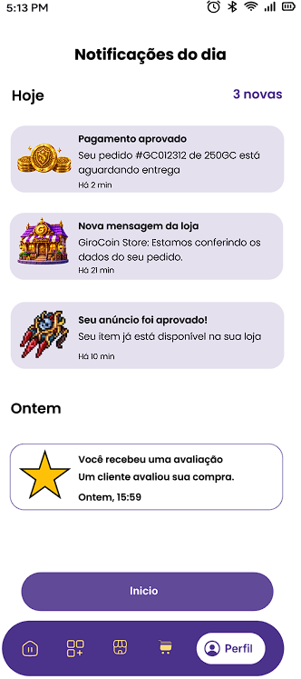

<div align="center">

  

# 🎮 GiroCoin — Mobile Marketplace

**"Seu jogo. Seu próximo level."**  
 _Conectando jogadores, facilitando trocas e impulsionando novas conquistas._

[](https://reactnative.dev/)
[](https://expo.dev/)
[](LICENSE)

</div>

---

## 📌 Sobre o Projeto

O **GiroCoin** é um _mobile marketplace_ completo desenvolvido especialmente para a comunidade gamer. A plataforma funciona como um ponto de encontro e negociação seguro onde jogadores podem comprar e vender moedas virtuais (**GiroCoins**), adquirir itens raros de jogos e contratar serviços (_boosts_, suporte e acompanhamento _in-game_).

> **Nossa Missão:** Jogadores conectam mundos. Nós conectamos você a eles!

---

## 📱 Galeria de Telas

<div align="center">
  <table>
    <tr>
      <td align="center" width="25%">
        <b>Splash Screen</b><br/><br/>
        
      </td>
      <td align="center" width="25%">
        <b>Tela de Login</b><br/><br/>
        
      </td>
      <td align="center" width="25%">
        <b>Home / Dashboard</b><br/><br/>
        
      </td>
      <td align="center" width="25%">
        <b>Notificações</b><br/><br/>
        
      </td>
    </tr>
  </table>
</div>

---

## 🎨 Identidade Visual & Conceito da Marca

A marca **GiroCoin** foi planejada para transmitir confiabilidade, inovação e paixão pelo universo gamer.

<div align="center">
  
</div>

<br/>

### 🎨 Paleta de Cores & Elementos

| Cor | Nome      | Aplicação / Significado                                       | Código Hex |
| :-: | :-------- | :------------------------------------------------------------ | :--------: |
| 🟡  | **Ouro**  | Representa valor, conquista, raridade e prestígio _in-game_.  | `#FFC700`  |
| 🟣  | **Roxo**  | Simboliza inovação, magia, crescimento e o ecossistema gamer. | `#4B318B`  |
| 🔵  | **Azul**  | Transmite confiança, comunidade, segurança e estabilidade.    | `#00A3FF`  |
| ⬛  | **Preto** | Traz a elegância do universo gamer, foco e modernidade.       | `#0D0D0D`  |

> **Conceito da Logomarca:** A letra **G** (formada pelos arcos roxo e azul) envolve a moeda de ouro em um ciclo contínuo (loop), representando um marketplace em movimento constante onde trocas acontecem com segurança.

---

## ✨ Funcionalidades Principais

- 🔍 **Busca e Filtros Inteligentes**: Barra de busca dinâmicapara encontrar rapidamente moedas, itens e serviços.
- 🪙 **Pacotes GiroCoin**: Escolha e adquira créditos virtuais (250, 500, 750 Giro Coins) para resgate imediato nas _stores in-game_.
- 🔔 **Central de Notificações**: Acompanhamento em tempo real do status de pedidos, aprovação de anúncios e avaliações recebidas.
- 🔐 **Autenticação Flexível**: Login seguro por e-mail e senha com suporte a Login Social (Google, Apple e Instagram).
- 🧭 **Barra de Navegação Animada (`ActionBar`)**: Menu inferior em estilo _pílula_ flutuante que se desloca suavemente entre as abas ativas.

---

## 🛠️ Tecnologias Utilizadas

- **Core**: [React Native](https://reactnative.dev/)
- **Plataforma/Toolchain**: [Expo](https://expo.dev/)
- **Navegação**: [React Navigation (Stack & Tabs)](https://reactnavigation.org/)
- **Animações**: Animated API do React Native (Pílula deslizante na `ActionBar`)
- **Ícones & UI**: Ícones Pixel-Art customizados e `@expo/vector-icons`

---

## 📦 Estrutura de Pastas do Projeto

```text
girocoin-mobile/
├── assets/                  # Arquivos de mídia e imagens estáticas
│   ├── branding.png         # Infográfico de branding e logo
│   ├── splash.png           # Captura da tela Splash
│   ├── login.png            # Captura da tela de Login
│   ├── dashboard.png        # Captura da tela Home
│   ├── notifications.png    # Captura da tela de Notificações
│   ├── imagemCoinG.png      # Ícone da moeda GiroCoin
│   ├── store.png            # Ícone da loja em Pixel-Art
│   ├── SanguineClw.png      # Ícone de item/anúncio
│   └── StarIcon.png         # Ícone de avaliação
├── src/
│   ├── components/          # Componentes reutilizáveis (ActionBar, Cards, etc.)
│   │   └── ActionBar.jsx
│   ├── screens/             # Telas do aplicativo
│   │   ├── SplashScreen.jsx
│   │   ├── LoginScreen.jsx
│   │   ├── HomeScreen.jsx
│   │   └── NotificationScreen.jsx
│   ├── navigation/          # Rotas e configurações do React Navigation
│   └── styles/              # Cores globais, temas e estilos
├── App.js                   # Componente raiz do React Native
├── package.json
└── README.md
```

---

## ⚡ Como Executar o Projeto

### Pré-requisitos

- **Node.js** (versão 18 ou superior)
- **NPM** ou **Yarn**
- Aplicativo **Expo Go** instalado no seu smartphone Android ou iOS

### Passo a Passo

1. **Clone o repositório:**

   ```bash
   git clone https://github.com/seu-usuario/girocoin-mobile.git
   cd girocoin-mobile
   ```

2. **Instale as dependências:**

   ```bash
   npm install
   ```

3. **Inicie o servidor do Expo com cache limpo:**

   ```bash
   npx expo start -c
   ```

4. **Abra no seu dispositivo:**
   - Abra o app **Expo Go** no Android e escaneie o QR Code que aparece no terminal.
   - No iOS, abra a Câmera nativa e escaneie o QR Code para abrir via Expo Go.

---

## 📄 Licença

Este projeto está desenvolvido sob a licença **MIT**. Consulte o arquivo `LICENSE` para obter mais detalhes.

---

<div align="center">
  <sub>Desenvolvido com ❤️ para a comunidade gamer.</sub>
</div>
